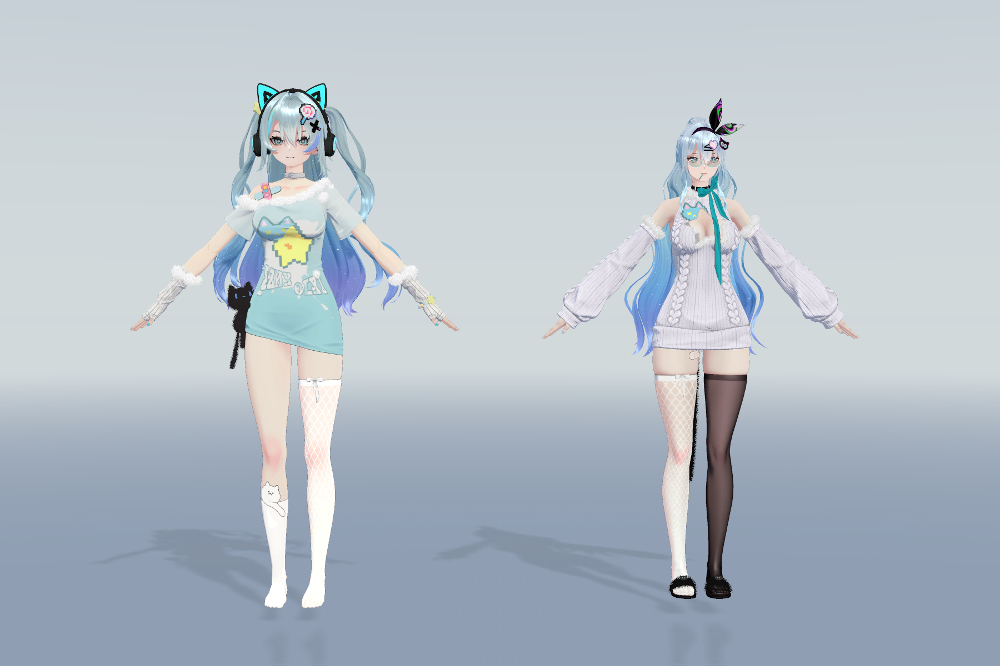

# Brahma Wujian · 梵天「无间玩伴」角色渲染

以双形态摄影棚场景展示角色表面着色、刘海阴影、毛绒衣料与平面反射，结合可读 Shader Graph 和 URP RenderGraph 多 Pass 实现。

## 展示入口

直接打开场景，观察两种形态在同一组灯光下的材质差异。可在 `BrahmaWujianPipeline` 上调整描边、Stencil 阴影、反射、头发透射、深度预通道和毛绒层数。[BrahmaWujianShowcase 场景](Scenes/BrahmaWujianShowcase.unity)

| 形态 | 视觉特征 | 预制体 |
| --- | --- | --- |
| 102003 | 浅蓝 T 恤、猫耳耳机、长袜 | [Brahma_Wujian_102003](Prefabs/Brahma_Wujian_102003.prefab) |
| 605603 | 白色针织衫、眼镜与头饰、非对称袜 | [Brahma_Wujian_605603](Prefabs/Brahma_Wujian_605603.prefab) |

## 技术实现

- Toon / Ramp 漫反射结合面部 SDF、头发渐变与各向异性高光，按材质分别控制皮肤、衣物、袜子和饰件。
- 刘海与脸部使用可逆 Stencil 流程。脸部写入 200，刘海阴影区域通过 Equal 与 IncrSat 标记为 201，脸部接收 Pass 着色后通过 DecrWrap 恢复为 200。
- 毛绒衣料使用 Fur Shell 分层绘制，默认 24 层，可通过 `furLayers` 调整。
- 独立反射 Render Target 与摄影棚地面配合，呈现模糊平面反射。环境 Cubemap、主光和冷色补光共同塑造材质。
- 七组普通节点的教学 Graph 展示 Base / Alpha、Toon / Ramp、Rim、高光 / RMO、头发、丝袜和面部合成，共 89 个节点、100 条连线、25 个属性。

## 渲染通道

| Pass | 用途 |
| --- | --- |
| `ForwardBase` | 表面着色与材质 Stencil 写入 |
| `Outline` | 反向壳轮廓 |
| `CharHairShadow` | 刘海阴影 Stencil 标记 |
| `CharFaceShadow` | 面部接收阴影并恢复 Stencil |
| `CharHairTransE` | 头发透射混合 |
| `ShadowCaster` | 主光阴影投射 |
| `Reflection` | 平面反射纹理 |
| `PreDepth` | 深度预通道 |
| `FurShell` | 毛绒层 |

Renderer Feature 按用途注册 RenderGraph Pass，反射在深度预通道前执行，Stencil 绘制先处理刘海、随后处理脸部接收面。辅助 Pass 使用专用 `Brahma*` LightMode 标签。

## 核心文件

| 文件 | 职责 |
| --- | --- |
| [BrahmaSurface.shadergraph](Shaders/BrahmaSurface.shadergraph) | 表面着色教学 Graph |
| [BrahmaCharacter.shader](Shaders/BrahmaCharacter.shader) | 运行时 Multipass Shader |
| [BrahmaCharacterCommon.hlsl](Shaders/BrahmaCharacterCommon.hlsl) | 公共光照、顶点与片元实现 |
| [BrahmaWujianRenderFeature.cs](Scripts/BrahmaWujianRenderFeature.cs) | RenderGraph 调度 |
| [BrahmaWujianPipeline.cs](Scripts/BrahmaWujianPipeline.cs) | 绘制对象收集、头部方向、反射矩阵与效果开关 |
| [CharacterPBRUber.PassContract.json](OriginalShader/CharacterPBRUber.PassContract.json) | Pass 顺序与固定渲染状态约定 |
| [BrahmaReferenceCalibration.cs](Editor/BrahmaReferenceCalibration.cs) | 摄影棚灯光、材质校准与截图 |

## 编辑器工具

菜单位于 `Tools > Studies > Brahma Wujian`。

- `Render Preview` 生成双形态总览，保存到 `Tools/AetherGazerResearch/BrahmaWujianPreview.png`。
- `Render Reference Views` 输出正面、侧面、背面、三分之四视角与局部近景。
- `Validate Rendering` 检查材质 Pass，并在 `.tmp` 输出反射和补光开关对照。
- `Validate Original Shader Contract` 检查 Pass 状态、教学 Graph 结构、Stencil 值与 Renderer Feature。
- `Apply Screenshot Calibration` 应用摄影棚灯光和材质预设，并保存场景。
- `Build Two-Form Study` 重建材质、预制体和展示场景，会覆盖生成内容上的手工调整。

教学 Graph 生成脚本位于 `Tools/AetherGazerResearch/build_brahma_graph.py`，重建已有 Graph 时需要显式传入 `--overwrite`。

## 当前展示范围

场景以静态双形态展示材质与 Pass 配合，灯光、环境反射和后处理参数围绕摄影棚效果调校。角色输入集中在 `SourceArt/102003` 与 `SourceArt/605603`，地面、天空和环境资源集中在 `Rendering`。
