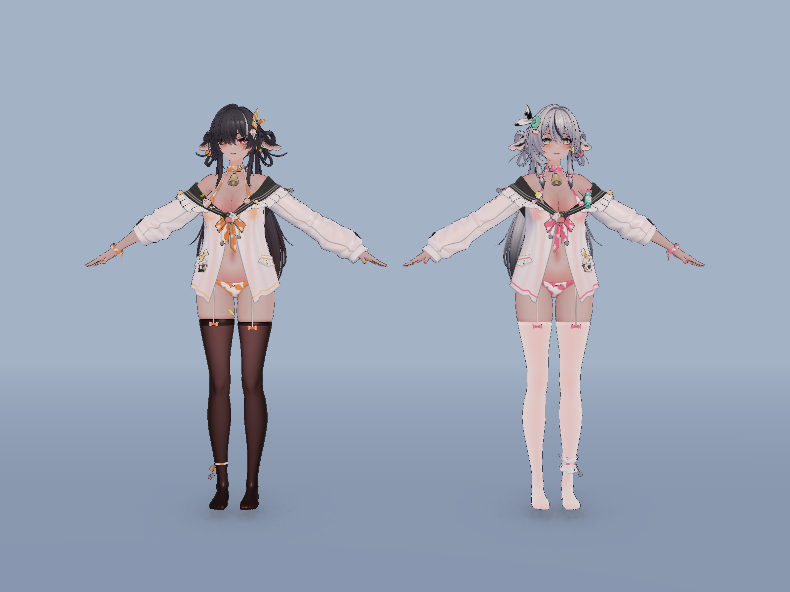

# Wuchang · 角色材质与多 Pass 渲染

通过双角色对照研究 Toon / Ramp、面部 SDF、头发高光、丝袜视角响应，以及 Stencil、描边、深度和反射的协作。

## 展示入口

直接打开展示场景，通过 Inspector 调整主光和材质参数。`WuchangCharacterPipeline` 提供深度预通道、描边、Stencil 刘海阴影、反射开关和刘海阴影偏移。[WuchangShowcase 场景](Scenes/WuchangShowcase.unity)

两组角色预制体分别为 `Wuchang_105401` 与 `Wuchang_614801`，便于在相同灯光下观察深浅袜材质与角色配色的差异。

## 表面着色

教学 Graph 包含 89 个普通节点、100 条连线与 25 个属性，按七组顺序展开。

1. 纹理采样、基础染色与 Alpha。
2. Half-Lambert、Toon 阈值与 Ramp。
3. 视角边缘光与遮罩。
4. 高光与 RMO 材质通道。
5. 头发各向异性高光。
6. 丝袜颜色、视角衰减与细节法线。
7. 面部 SDF 与最终合成。

运行时材质使用 `WuchangCharacter.shader`，公共 HLSL 负责表面计算和各 Pass 的顶点、片元逻辑。

## 渲染通道

| Pass | 用途 |
| --- | --- |
| `ForwardBase` | 角色表面与材质 Stencil |
| `Outline` | 反向壳描边 |
| `CharHairShadow` | 刘海阴影区域标记 |
| `CharFaceShadow` | 脸部接收阴影与 Stencil 恢复 |
| `CharHairTransE` | 头发透射 Pass 定义 |
| `ShadowCaster` | URP 阴影投射 |
| `Reflection` | 独立反射纹理 |
| `PreDepth` | 深度预通道 |

`WuchangCharacterRenderFeature` 调度深度、描边、头发与脸部 Stencil 阴影以及反射。脸部写入 200，刘海阴影将满足条件的区域标记为 201，脸部接收后恢复为 200。场景组件提供绘制列表、头部朝向、光照参数与反射矩阵。

## 核心文件

| 文件 | 职责 |
| --- | --- |
| [WuchangSurface.shadergraph](Shaders/WuchangSurface.shadergraph) | 普通节点组成的表面教学 Graph |
| [WuchangCharacter.shader](Shaders/WuchangCharacter.shader) | 八 Pass 角色 Shader |
| [WuchangCharacterCommon.hlsl](Shaders/WuchangCharacterCommon.hlsl) | 光照与公共 Pass 实现 |
| [WuchangCharacterRenderFeature.cs](Scripts/WuchangCharacterRenderFeature.cs) | URP RenderGraph 调度 |
| [WuchangCharacterPipeline.cs](Scripts/WuchangCharacterPipeline.cs) | 场景绘制数据与效果开关 |
| [WuchangLighting.cs](Scripts/WuchangLighting.cs) | 光向与半角向量更新 |

## 编辑器工具

菜单位于 `Tools > Studies > Wuchang`。

- `Render Preview` 将场景预览写入 `Tools/AetherGazer/WuchangPreview.png`。
- `Install Original Pass Pipeline` 配置运行时 Shader 与 Renderer Feature。
- `Build Showcase` 根据 `Tools/AetherGazer/material_bindings.json` 重建材质、预制体与场景，随后可安装运行时 Pass 管线。

构建操作会重新生成展示内容。现有展示入口为保存好的 `Scenes/WuchangShowcase.unity`，地面材质位于 `Rendering/WuchangFloor.mat`。

## 当前展示范围

场景聚焦静态角色材质与多 Pass 行为对照。各材质的 Ramp、阴影、高光、丝袜参数与场景光照共同决定最终效果。
