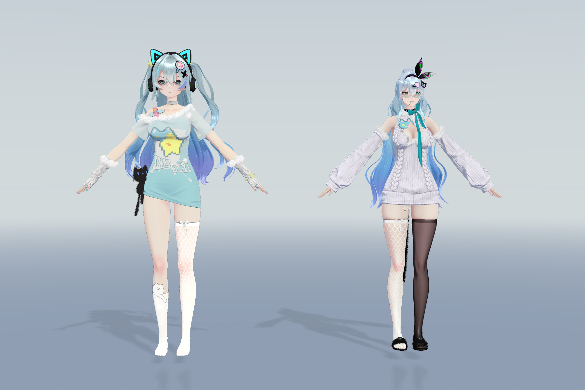
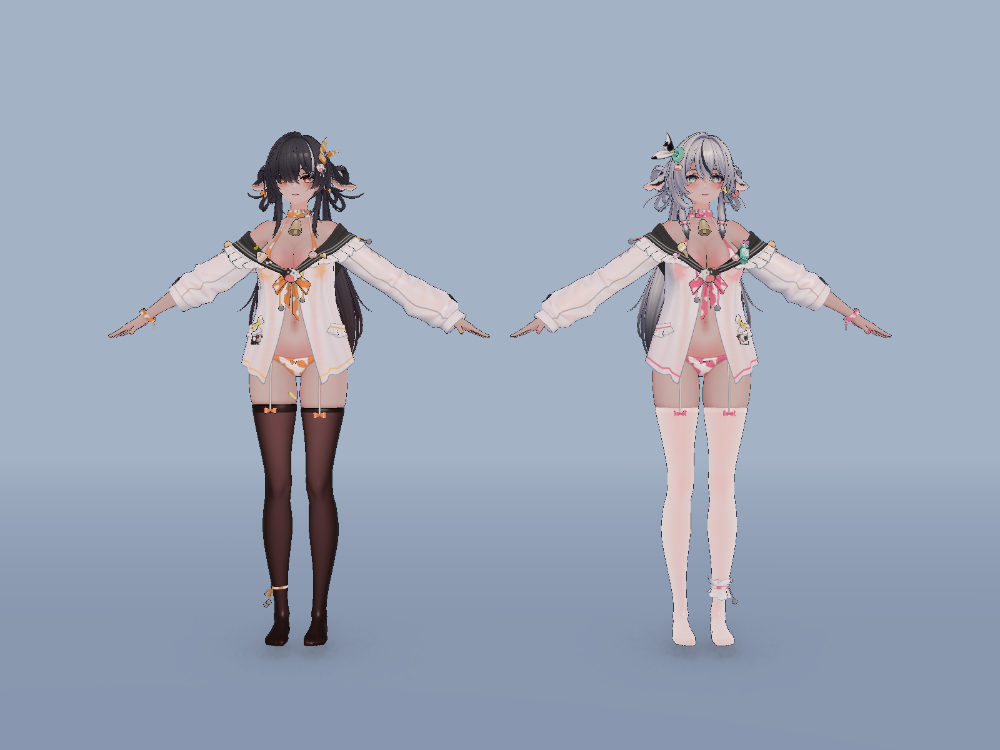

# Toon Shader · Unity 角色渲染作品集

基于 Unity 6 与 Universal Render Pipeline 的角色渲染研究项目，围绕多个角色展示 NPR / PBR 混合着色、面部 SDF、头发高光与投影、描边、透明衣料、湿润效果和多 Pass 渲染，并提供可交互的材质观察场景。

项目的技术工作集中在 Shader 编写、Shader Graph 可视化、URP RenderGraph 适配、材质调校，以及换装和光照调试工具。角色模型、贴图与角色设计作为效果展示素材，相关权益归各自权利人。

## 作品与技术重点

| Study | 展示内容 | 技术重点 |
| --- | --- | --- |
| [Clukay · 可露凯](Assets/Studies/ClukayStudy/README.md) | 三组部件、27 种搭配与 Summer416 | NPR / PBR 混合光照、透明衣料、各向异性高光、材质诊断 |
| [Brahma Wujian · 梵天「无间玩伴」](Assets/Studies/BrahmaWujianStudy/README.md) | 双形态摄影棚展示 | Stencil 刘海阴影、面部 SDF、Fur Shell、平面反射 |
| [Wuchang](Assets/Studies/WuchangStudy/README.md) | 双角色材质对照 | 八 Pass 角色 Shader、Ramp、丝袜视角响应、Stencil 调度 |
| [Linnae · 琳奈](Assets/Studies/LinnaeStudy/README.md) | 光照与效果开关对照 | 四通道面部 SDF、独立头发深度图、PCF、像素宽描边 |
| [Liino · 莉诺](Assets/Studies/LiinoStudy/README.md) | 干湿、雨滴与局部浸水交互 | 湿润遮罩、粗糙度变化、GGX、布料与头发高光 |
| [Anke · 安可](Assets/Studies/AnkeStudy/README.md) | 共用骨架的两套服装 | 分层颜色合成、换装显隐、透明丝袜、颈部校色 |
| [Daiyan · 黛烟](Assets/Studies/DaiyanStudy/README.md) | 部位穿搭与灯光预览 | 亮暗基底合成、蒙皮描边、表情同步、接缝处理 |
| [Encore](Assets/Studies/EncoreStudy/README.md) | Shader Graph 专题 | 身体颜色遮罩分层与角色光照组合 |

### 场景预览

梵天双形态与摄影棚材质表现。



Wuchang 双角色光照与材质对照。



## 打开项目

1. 使用 Unity Hub 打开仓库根目录，编辑器版本为 **6000.4.7f1**。
2. 等待 Package Manager 解析依赖并完成资源导入。项目使用 **URP / Shader Graph 17.4.0**，色彩空间为 **Linear**。
3. 从对应 Study 的 `Scenes` 目录打开 `*Showcase.unity`，在 Game 视图观察效果。
4. Anke、Clukay、Daiyan、Liino 和 Linnae 提供运行时交互控件。Wuchang 与 Brahma 可通过 Inspector 调整灯光、材质和 Pass 开关。

当前构建场景列表启用 AnkeShowcase。其他展示场景可直接在编辑器中打开，制作独立构建时将目标场景加入 Build Profiles 的场景列表。Encore 提供着色器专题入口。

## 实现结构

**表面着色**围绕 Toon 明暗、Ramp、材质遮罩、GGX / 各向异性高光、环境反射和透明覆盖率展开。Clukay、Brahma 与 Wuchang 提供普通节点组成的教学 Shader Graph，运行时材质由对应 Multipass Shader 驱动。Liino、Linnae 与 Encore 使用 Shader Graph 配合 HLSL Custom Function。

**角色渲染通道**由 Renderer Feature 与场景组件协作完成，包括头发投脸阴影、反向壳描边、深度预通道、平面反射和毛绒层。场景组件负责收集绘制对象、传递头部方向并管理效果开关。

**交互与验证**通过换装、转台、灯光旋转、调试输出和局部效果开关辅助观察。现有编辑器工具提供材质状态检查、Pass 约定检查和预览截图。

## 目录

```text
Assets/
  Settings/             共用 URP 配置
  Studies/              各角色场景、Shader、材质和模型
Packages/               包依赖与锁定版本
ProjectSettings/        Unity 项目设置
Tools/                  构建辅助数据、图生成工具与预览
```

Anke 直接复用 LinnaeStudy 的光照 HLSL、面部 SDF 和角色渲染组件。各 Study 的入口与共享依赖汇总在学习索引中。[Study 索引](Assets/Studies/README.md)
